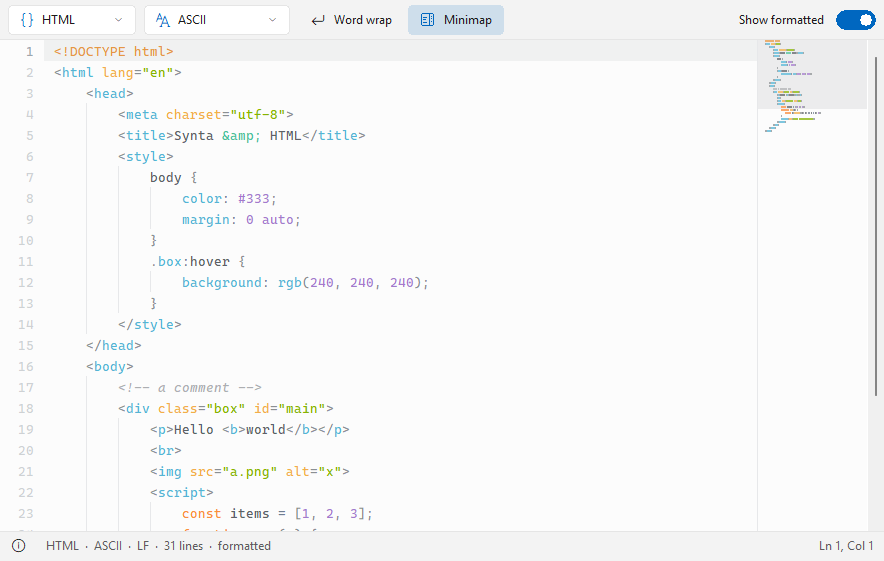

# Synta

**English** | [Deutsch](README.de.md)

A source code viewer with syntax highlighting (Lister plugin) for [Total Commander](https://www.ghisler.com), 32 and 64 bit.
Press F3 on a source file and read it right there – with syntax highlighting, line numbers and an optional minimap. A switch shows minified or messy code formatted – the file itself is never changed. Languages and color schemes are plain text files that anyone can extend. Native, no runtime, nothing to install besides the plugin.



## Supported languages

C, C++, C#, Java, JavaScript, TypeScript, Python, PowerShell, Batch, Shell, SQL, Go, Rust, PHP, HTML (with embedded CSS and JavaScript), Astro, XML, CSS, SCSS/Less, JSON, YAML, TOML, INI, Registry files, Markdown, Diff, Lua, Pascal/Delphi, Visual Basic, Ruby, Kotlin, Swift, AutoHotkey, AutoIt, Makefile, Dockerfile, CMake, EDIFACT, CSV/TSV (every column in its own color) and Synta's own definition files.

Files without an extension are recognized by their name (`Makefile`, `Dockerfile`) by a `#!` line or, for Registry exports, by the header; any other text file without an extension is shown as plain text (`ExtensionlessText=0` in `Synta.ini` turns this off).

## Features

- **Show formatted** (Ctrl+B, switch at the top right): JSON, XML, HTML, CSS, SQL and C-like languages pretty-printed; only white space changes
- Word wrap (`W`), minimap, line numbers, indent guides, highlighted current line
- Language picker at the top left, in case a file was recognized wrongly
- Select with the mouse (double-click: word, click on a line number: line), copy with Ctrl+C, select all with Ctrl+A
- URLs (http, https, ftp, www., mailto) are colored as links; Ctrl+click opens one in the default browser or mail program (the pointer turns into a hand while Ctrl is held; `LinkClick=1` makes a plain click enough)
- Search with Total Commander's Find (F7 / F3), go to line (Ctrl+G)
- Zoom with Ctrl+mouse wheel; selectable font and tab width
- Printing (File > Print): colored on white paper, with line numbers unless `PrintLineNumbers=0`; Total Commander's "wrap text" and "fit to page" options are respected; with text selected, "Selection" prints only that text
- Light and dark design (automatic like Windows, like Total Commander, or fixed) in the Windows 11 look; color schemes Ayu (Light, Dark, Mirage, Mirage Light), GitHub, Solarized, One, Catppuccin, Gruvbox, Tokyo Night, Rosé Pine and Visual Studio (each in a light and a dark variant)
- Text encodings: UTF-8, UTF-16 (with or without BOM) and legacy code pages (Windows 125x, CP866, CP850, KOI8, Shift-JIS, GBK, Big5, ...), detected automatically and switchable in the context menu (Encoding); DOS text (box drawing characters, umlauts) is recognized as CP437/CP850/CP852/CP866, and NFO, DIZ, ASC and ANS files open as CP437 by default; files up to 512 MB
- Status bar with language, encoding, line endings, number of lines and the cursor position
- English and German user interface (follows the Windows language)

## Own languages and color schemes

- `Languages\*.lang`: one file per language (keywords, comments, strings, …). `Languages\_template.lang` explains every key.
- `Languages\global.lang`: settings for all languages. `Links=` lists the URL prefixes that are colored as links in text, comments and strings; a language can override or empty the key. `LinkEnd=` sets the characters that end a URL, `LinkAfter=` (e.g. `href=" src="`) starts a link right behind such a prefix. Put your own values into `Languages\global.user.lang` (same format, only the keys you change): it overrides `global.lang` and an update never touches it. Plain text files (`.txt`, `.log`) are shown by `Languages\text.lang`.
- `Themes\*.theme`: one file per color scheme; colors as `#RRGGBB` or `#RRGGBBAA`, optionally bold / italic.
- Context menu → *Open "Languages" folder* / *Open "Themes" folder*. New or changed files are used for the next file the Lister opens; errors are shown in the status bar and under *Errors in definition files…*.
- To add to a built-in language, create `Languages\<name>.user.lang` next to `<name>.lang` (for example `html.user.lang`): only the keys you set replace the original values, while word lists, `Extensions=`, `FileNames=` and `Shebang=` are added to; an update never touches these files. To change a built-in language completely, copy its file and set `Priority=1` in the copy – an update replaces the built-in files, not your copy.

## Detect string

Total Commander only offers Synta the files its *detect string* matches. Synta builds it from the extensions of all `Languages\*.lang` files when the plugin is installed, so only known source file types open in Synta (plus files without an extension, which Synta checks itself). `.ts` and `.mts` need the `MULTIMEDIA` term, because Total Commander treats them as video.

Total Commander allows 2 KB for the detect string. If the list of extensions gets longer than that (many own languages), Synta falls back to "everything except common binary types" (`!(EXT="EXE"|EXT="DLL"|…)`); files without a language are then declined when they are loaded.

To limit Synta to the types you want, edit the string in *Configuration → Options → Plugins → Lister plugins → Synta → Configure*, or `detect=` in the `[ListerPlugins]` section of `wincmd.ini` (only with Total Commander closed):

```
EXT=""|EXT="C"|EXT="H"|EXT="CPP"|EXT="PY"|EXT="JS"|EXT="JSON"|EXT="LANG"|EXT="THEME"|(MULTIMEDIA & (EXT="TS"|EXT="MTS"))
```

## Download and installation

1. Download **`Synta.zip`** from the [latest release](https://github.com/naderi/tc-synta/releases/latest).
2. Open the ZIP in Total Commander (Enter on the file) and confirm the question whether to install the plugin.

Settings are stored in `Synta.ini` next to the plugin (all keys are described in the [Settings](#settings) section). Requires Windows 10 or 11.

JSON and XML are also shown by [TreeView](https://totalcmd.net/plugins/treeview) (as tree and grid). If both plugins are installed, the one listed first in *Configuration → Plugins → Lister plugins* opens these files.

## Keys

| Key | Action |
|---|---|
| Ctrl+B | *Show formatted* on / off |
| Ctrl+G | *Go to line…* |
| Ctrl+A, Ctrl+C | Select all, copy |
| F7 / F3 | Find (Total Commander's search) |
| Ctrl+mouse wheel | Zoom |
| Arrow keys, Page Up / Down, Home, End | Scroll |
| F1 | About |

More options – *Word wrap*, *Minimap*, *Line numbers*, *Text cursor*, *Buttons* (top, status bar or hidden), *Tab width*, *Line spacing*, *Theme*, *Color scheme*, *Font…* – are in the context menu (right click).

## Settings

`Synta.ini` (section `[Synta]`) is created next to the plugin on first use; if that folder is read-only, next to Total Commander's `lsplugin.ini`. Most values can also be changed in the Lister; they are written back to the file.

| Key | Values | Meaning |
|---|---|---|
| `Theme` | `0` automatic (default), `1` light, `2` dark, `3` like Total Commander | `0` is dark if Total Commander or Windows is dark; `3` follows only Total Commander's dark mode |
| `LightScheme` | scheme name (default `Ayu Light`) | Color scheme in light mode |
| `DarkScheme` | scheme name (default `Ayu Dark`) | Color scheme in dark mode (also `Ayu Mirage`) |
| `Font` | font name (default `Cascadia Mono`) | Code font, fixed-pitch fonts only |
| `FontSize` | `6`–`40` (default `10`, decimals allowed) | Size in points |
| `TabWidth` | `1`–`16` (default `4`) | Width of a tab in characters |
| `Wrap` | `1` / `0` (default `0`) | Word wrap |
| `LineNumbers` | `1` / `0` (default `1`) | Line numbers |
| `Formatted` | `1` / `0` (default `0`) | Show formatted |
| `Minimap` | `1` / `0` (default `0`) | Minimap |
| `Buttons` | `1` / `2` / `0` (default `1`) | Where the language, word wrap, minimap and *Show formatted* buttons sit: `1` top bar, `2` status bar, `0` hidden; everything stays available in the context menu. An older `TopBar=0` becomes `2`. |
| `LineSpacing` | `0`–`40` (default `4`) | Extra space between lines in pixels |
| `Cursor` | `1` / `0` (default `1`) | Text cursor: arrow keys move it (Shift selects, Ctrl+arrows jump by word, Ctrl+Home / End), instead of scrolling |
| `LinkClick` | `1` / `0` (default `0`) | `1`: a plain click on a link opens it (a click that selects text does not); `0`: Ctrl+click |
| `LinkUnderline` | `1` / `0` (default `0`) | Underline links |
| `PrintLineNumbers` | `1` / `0` (default `1`) | Line numbers in the printout |
| `DetectEncoding` | `1` / `0` (default `1`) | Guess the code page of files that are not UTF-8; `0` always uses `DefaultCodepage` |
| `DefaultCodepage` | code page number, e.g. `437`, `1251` (default `0` = the Windows code page) | Code page for files that are not UTF-8 and where detection finds nothing better |

## License

Freeware – free to use, but **not for sale**. See [LICENSE](LICENSE). Color palette Ayu by dempfi (MIT license).

## Support

If Synta saves you time, you can support its development on Ko‑fi. ☕

<a href='https://ko-fi.com/N7N123QIX0' target='_blank'></a>

---

© 2026 [Ali Naderi](https://github.com/naderi) · [digitalent.dev](https://digitalent.dev/en/)
