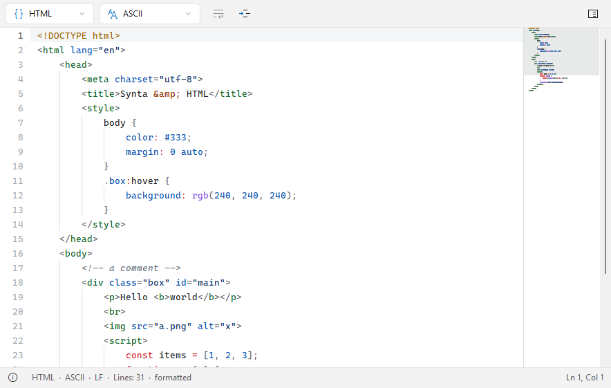

# Synta

**English** | [Deutsch](README.de.md)

A source code viewer with syntax highlighting (Lister plugin) for [Total Commander](https://www.ghisler.com), 32 and 64 bit.
Press F3 on a source file and read it right there – with syntax highlighting, line numbers and an optional minimap. A button shows minified or messy code formatted – the file itself is never changed. Languages and color schemes are plain text files that anyone can extend. Native, no runtime, nothing to install besides the plugin.



## Supported languages

C, C++, C#, Java, JavaScript, TypeScript, Python, PowerShell, Batch, Shell, SQL, Go, Rust, PHP, HTML (with embedded CSS and JavaScript), Astro, XML, CSS, SCSS/Less, JSON, YAML, TOML, INI, Registry files, Total Commander menus (.mnu) and button bars (.bar), Markdown, Diff, Lua, Pascal/Delphi, Visual Basic, Ruby, Kotlin, Swift, AutoHotkey, AutoIt, Makefile, Dockerfile, CMake, LaTeX, EDIFACT, CSV/TSV (every column in its own color) and Synta's own definition files.

Files without an extension are recognized by their name (`Makefile`, `Dockerfile`) by a `#!` line or, for Registry exports, by the header; any other text file without an extension is shown as plain text (`ExtensionlessText=0` in `Synta.ini` turns this off).

## Features

- **Show formatted** (Ctrl+Shift+B, icon button next to *Word wrap*): JSON, XML, HTML, CSS, SQL and C-like languages pretty-printed; only white space changes
- **Code folding** for every language: chevrons in the gutter (click), `Ctrl+Shift+[` / `]` (German keyboard: `ß` / `´`; also `=` / `\`) fold and unfold the block around the cursor, `Ctrl+Alt+` the same keys all blocks, `Ctrl+Shift+/` and `Ctrl+Alt+/` toggle (number pad: `Ctrl+-` / `Ctrl++`, with Shift for all); also in the context menu under *Code folding*. Blocks come from brackets and indentation (Markdown: headings, INI: sections). Optionally the number of hidden lines is shown behind the dots: `... (121 Lines)`
- **NFO, DIZ and ANS files** open with tight lines, so ASCII art stays connected (*Line spacing* → *Always tight for NFO/DIZ*)
- Word wrap (`W`) and minimap as icon buttons – dimmed while off, with tooltips; line numbers, indent guides and a column line at the cursor (both switchable under *View elements*), highlighted current line
- Language picker at the top left, in case a file was recognized wrongly; next to it the encoding picker (UTF-8, UTF-16, Windows and DOS code pages), also in the context menu
- Select with the mouse (double-click: word, click on a line number: line), copy with Ctrl+C, select all with Ctrl+A
- URLs (http, https, ftp, www., mailto) are colored as links; Ctrl+click opens one in the default browser or mail program (the pointer turns into a hand while Ctrl is held; `LinkClick=1` makes a plain click enough)
- Search with Total Commander's Find (F7 / F3), go to line (Ctrl+G), jump to the matching bracket (Ctrl+B; the bracket pair next to the cursor is highlighted); F4 edits the file in Total Commander's editor
- Zoom with Ctrl+mouse wheel; selectable font and tab width
- Printing (File > Print): colored on white paper, with line numbers unless `PrintLineNumbers=0`; Total Commander's "wrap text" and "fit to page" options are respected; with text selected, "Selection" prints only that text
- Light and dark design (automatic like Windows, like Total Commander, or fixed) in the Windows 11 look; color schemes Ayu (Light, Dark, Mirage, Mirage Light), GitHub, Solarized, One, Catppuccin, Gruvbox, Tokyo Night, Rosé Pine and Visual Studio (each in a light and a dark variant)
- Text encodings: UTF-8, UTF-16 (with or without BOM) and legacy code pages (Windows 125x, CP866, CP850, KOI8, Shift-JIS, GBK, Big5, ...), detected automatically and switchable in the context menu (Encoding); DOS text (box drawing characters, umlauts) is recognized as CP437/CP850/CP852/CP866, and NFO, DIZ, ASC and ANS files open as CP437 by default; files up to 512 MB
- Status bar with language, encoding, line endings, number of lines (`Lines: 250 (12)` – 12 of 250 lines selected) and the cursor position
- English and German user interface (follows the Windows language)

## Own languages and color schemes

- `Syntaxes\*.syntax`: one file per language (keywords, comments, strings, …). `Syntaxes\_template.syntax` explains every key. `Folding=` sets how a language folds: `none`, `braces`, `indent`, `headings` or `sections` (default: from the language type).
- `Syntaxes\global.syntax`: settings for all languages. `Links=` lists the URL prefixes that are colored as links in text, comments and strings; a language can override or empty the key. `LinkEnd=` sets the characters that end a URL, `LinkAfter=` (e.g. `href=" src="`) starts a link right behind such a prefix. Put your own values into `Syntaxes\global.user.syntax` (same format, only the keys you change): it overrides `global.syntax` and an update never touches it. Plain text files (`.txt`, …) are shown by `Syntaxes\text.syntax`, log files by `Syntaxes\log.syntax` (a line is colored by its level).
- `Themes\*.json`: one file per color scheme, in the VS Code color theme format – the same files the editor Syntax uses, so themes from VS Code work as they are. `colors` holds the editor colors (`editor.selectionForeground` sets the text color inside the selection, `tree.tableOddRowsBackground` the color of the alternating rows), `tokenColors` the colors of the syntax styles by TextMate scope (`#RRGGBB` or `#RRGGBBAA`, `fontStyle` bold / italic); a scope also covers its sub-scopes (`keyword` colors `keyword.control` too). Styles that VS Code has no common scope for use `keyword.control.flow`, `entity.other.inherited-class`, `keyword.other.unit`, `constant.character.escape`, `constant.character.entity`, `meta.annotation`, `entity.name.section`, `punctuation` and `markup.changed`; a theme that leaves them out gets the color of the next more general scope. Older `Themes\*.theme` files are still read.
- Context menu → *Open "Syntaxes" folder* / *Open "Themes" folder* (opens in a new tab of Total Commander). New or changed files are used for the next file the Lister opens; errors are shown in the status bar and under *Errors in definition files…*.
- To add to a built-in language, create `Syntaxes\<name>.user.syntax` next to `<name>.syntax` (for example `html.user.syntax`): only the keys you set replace the original values, while word lists, `Extensions=`, `FileNames=` and `Shebang=` are added to; an update never touches these files. To change a built-in language completely, copy its file and set `Priority=1` in the copy – an update replaces the built-in files, not your copy.
- Updating from a version before 1.7: Synta moves your own files from `Languages\*.lang` to `Syntaxes\*.syntax` by itself (also `*.user.lang`), the first time it runs. Nothing to do by hand.

## Detect string

Total Commander only offers Synta the files its *detect string* matches. Synta builds it from the extensions of all `Syntaxes\*.syntax` files when the plugin is installed, so only known source file types open in Synta (plus files without an extension, which Synta checks itself). `.ts` and `.mts` need the `MULTIMEDIA` term, because Total Commander treats them as video.

Total Commander allows 2 KB for the detect string. If the list of extensions gets longer than that (many own languages), Synta falls back to "everything except common binary types" (`!(EXT="EXE"|EXT="DLL"|…)`); files without a language are then declined when they are loaded.

To keep single file types away from Synta without touching this string, list them in `ExcludeExtensions=` in `Synta.ini` (for example `ts mts`): Synta then declines these files and Total Commander uses its next viewer.

To limit Synta to the types you want, edit the string in *Configuration → Options → Plugins → Lister plugins → Synta → Configure*, or `detect=` in the `[ListerPlugins]` section of `wincmd.ini` (only with Total Commander closed):

```
EXT=""|EXT="C"|EXT="H"|EXT="CPP"|EXT="PY"|EXT="JS"|EXT="JSON"|EXT="LANG"|EXT="THEME"|(MULTIMEDIA & (EXT="TS"|EXT="MTS"))
```

## Download and installation

1. Download **`Synta.zip`** from the [latest release](https://github.com/naderi/tc-synta/releases/latest).
2. Open the ZIP in Total Commander (Enter on the file) and confirm the question whether to install the plugin.

Settings are stored in `Synta.ini` next to the plugin (all keys are described in the [Settings](#settings) section). Requires Windows 10 or 11.

JSON and XML are also shown by [TreeView](https://totalcmd.net/plugins/treeview) (as tree and grid). If both plugins are installed, the one listed first in *Configuration → Plugins → Lister plugins* opens these files.

## Keys

| Key | Action |
|---|---|
| Ctrl+B | *Go to matching bracket* |
| Ctrl+Shift+B | *Show formatted* on / off |
| Ctrl+G | *Go to line…* |
| Ctrl+Shift+[ / ] (German: ß / ´) | Fold / unfold the block at the cursor (number pad: Ctrl+- / Ctrl++) |
| Ctrl+Alt+[ / ] (German: ß / ´) | Fold / unfold all blocks (number pad: Ctrl+Shift+- / Ctrl+Shift++) |
| Ctrl+A, Ctrl+C | Select all, copy |
| F7 / F3 | Find (Total Commander's search) |
| F4 | Edit the file in the editor configured in Total Commander |
| Ctrl+mouse wheel | Zoom |
| Arrow keys, Page Up / Down, Home, End | Scroll |
| F1 | About |

More options – *Word wrap*, *Minimap*, *Line numbers*, *Text cursor*, *Buttons* (top, status bar or hidden), *Tab width*, *Line spacing*, *Theme*, *Color scheme*, *Font…* – are in the context menu (right click).

## Settings

`Synta.ini` (section `[Synta]`) is created next to the plugin on first use; if that folder is read-only, next to Total Commander's `lsplugin.ini`. Most values can also be changed in the Lister; they are written back to the file.

| Key | Values | Meaning |
|---|---|---|
| `Theme` | `0` automatic (default), `1` light, `2` dark, `3` like Total Commander | `0` is dark if Total Commander or Windows is dark; `3` follows only Total Commander's dark mode |
| `LightScheme` | scheme name (default `Ayu Light`) | Color scheme in light mode |
| `DarkScheme` | scheme name (default `Ayu Dark`) | Color scheme in dark mode (also `Ayu Mirage`) |
| `Font` | font name (default `Cascadia Mono`) | Code font, fixed-pitch fonts only |
| `FontSize` | `6`–`40` (default `10`, decimals allowed) | Size in points |
| `TabWidth` | `1`–`16` (default `4`) | Width of a tab in characters |
| `Wrap` | `1` / `0` (default `0`) | Word wrap |
| `LineNumbers` | `1` / `0` (default `1`) | Line numbers |
| `Formatted` | `1` / `0` (default `0`) | Show formatted |
| `Minimap` | `1` / `0` (default `0`) | Minimap |
| `Buttons` | `1` / `2` / `0` (default `1`) | Where the language, encoding, word wrap, minimap and *Show formatted* buttons sit: `1` top bar, `2` status bar, `0` hidden; everything stays available in the context menu. An older `TopBar=0` becomes `2`. |
| `LineSpacing` | `0`–`40` (default `4`) | Extra space between lines in pixels |
| `Cursor` | `1` / `0` (default `1`) | Text cursor: arrow keys move it (Shift selects, Ctrl+arrows jump by word, Ctrl+Home / End), instead of scrolling |
| `EditorArgs` | empty (default) or a parameter template | With the text cursor on, F4 starts the editor set in Total Commander with these parameters instead of its own, so the editor can open the file at the cursor. `%1` or `%FILE%` is the file, `%LINE%` and `%COL%` the cursor position (counted from 1, the column in characters). Examples: `%1 /GoTo(%LINE%:%COL%)` (AkelPad), `"%FILE%:%LINE%:%COL%"` (Syntax). Empty: the editor gets just the file |
| `LinkClick` | `1` / `0` (default `0`) | `1`: a plain click on a link opens it (a click that selects text does not); `0`: Ctrl+click |
| `LinkUnderline` | `1` / `0` (default `0`) | Underline links |
| `LineBackground` | `1` / `0` (default `0`) | Log files: tint the whole row of a line in the color of its level (ERROR, WARN, …); also in the context menu under *View elements* → *Line background (logs)* |
| `AlternateRows` | `1` / `0` (default `0`) | Every second line gets a faint background (like *Background 2* in Total Commander); also in the context menu under *View elements* → *Alternating row background* |
| `FoldCount` | `1` / `0` (default `0`) | Show the number of hidden lines behind the dots of a folded block, e.g. `... (121 Lines)`; also in the context menu under *Code folding* |
| `IndentGuides` | `1` / `0` (default `1`) | Vertical lines at every tab stop of the indentation; also in the context menu under *View elements* → *Indent guides* |
| `ColumnGuide` | `1` / `0` (default `0`) | A vertical line at the column of the cursor; also in the context menu under *View elements* → *Cursor column line* |
| `AutoTight` | `1` / `0` (default `1`) | Files with an extension from `TightExtensions` get no extra line spacing; also in the context menu under *Line spacing* → *Always tight for NFO/DIZ* |
| `TightExtensions` | extensions (default `nfo diz ans`) | File types shown with tight lines when `AutoTight=1`; separated by spaces, commas or semicolons |
| `ExcludeExtensions` | empty (default) or extensions, e.g. `ts mts` | File types that Synta declines, so Total Commander uses its next viewer; separated by spaces, commas or semicolons |
| `PrintLineNumbers` | `1` / `0` (default `1`) | Line numbers in the printout |
| `DetectEncoding` | `1` / `0` (default `1`) | Guess the code page of files that are not UTF-8; `0` always uses `DefaultCodepage` |
| `DefaultCodepage` | code page number, e.g. `437`, `1251` (default `0` = the Windows code page) | Code page for files that are not UTF-8 and where detection finds nothing better |

## License

Freeware – free to use, but **not for sale**. See [LICENSE](LICENSE). Color palette Ayu by dempfi (MIT license).

## Support

If Synta saves you time, you can support its development on Ko‑fi. ☕

<a href='https://ko-fi.com/N7N123QIX0' target='_blank'></a>

---

© 2026 [Ali Naderi](https://github.com/naderi) · [digitalent.dev](https://digitalent.dev/en/)
